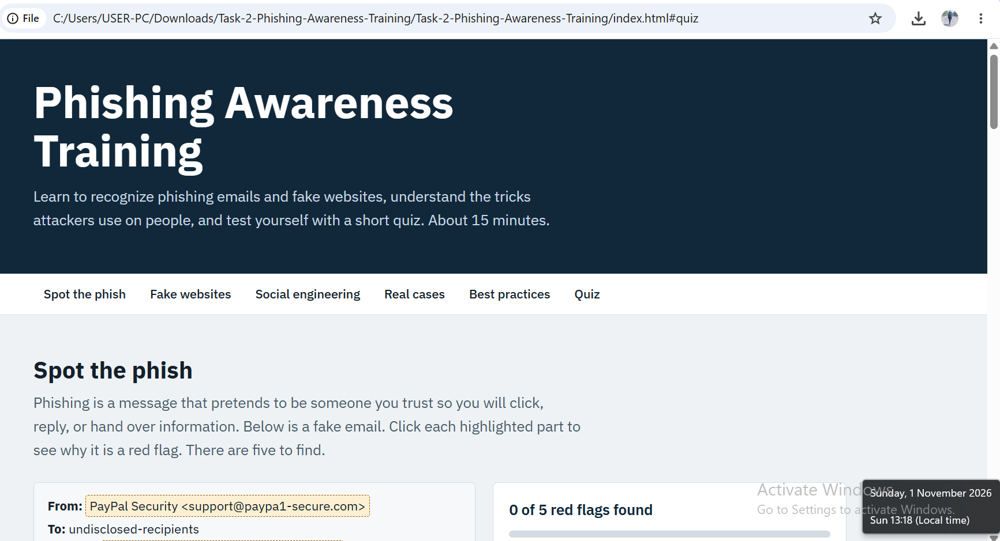
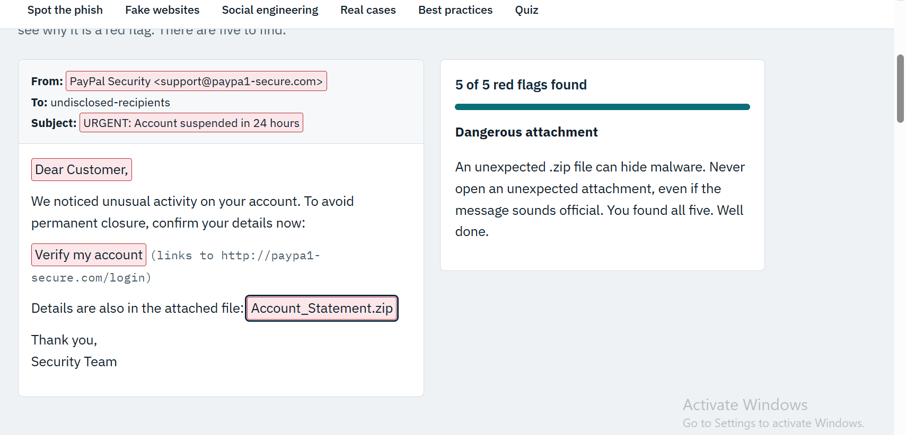
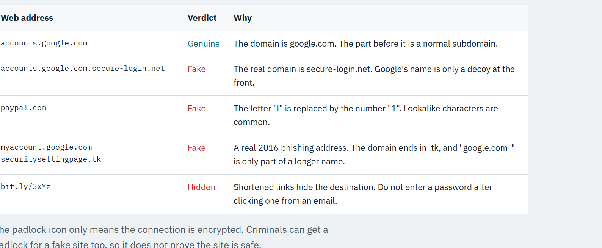
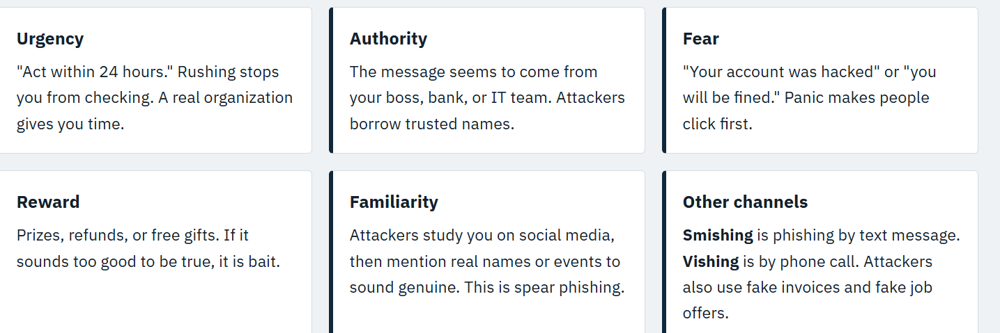
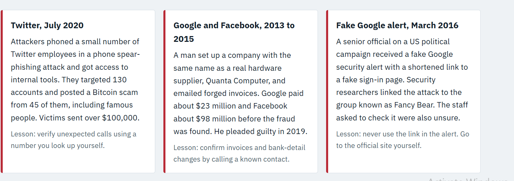
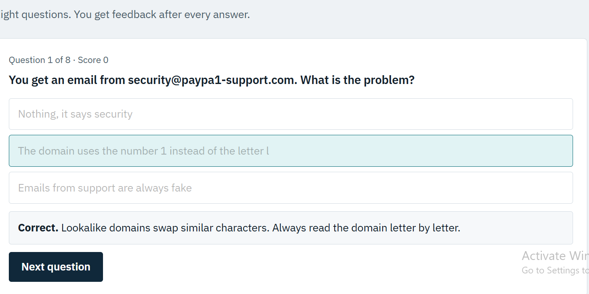
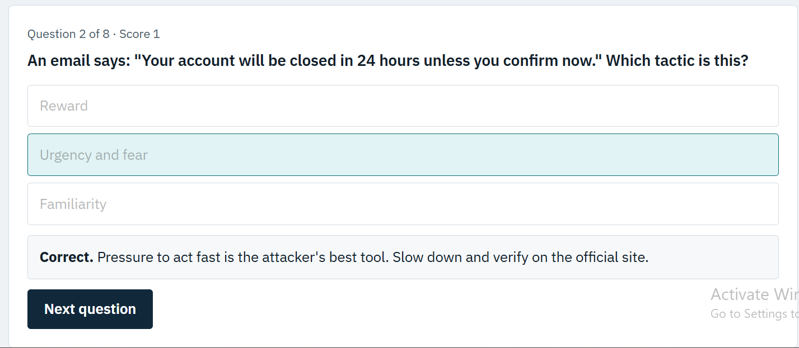
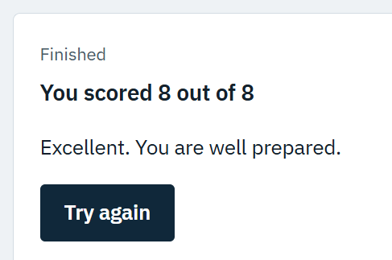

# Task 2: Phishing Awareness Training

**CodeAlpha Cybersecurity Internship**



## Project Overview

This project is an interactive online training module about phishing attacks. It teaches people how to recognize phishing emails and fake websites, explains the social engineering tactics attackers use, gives best practices for staying safe, presents real-world cases, and ends with an interactive quiz.

The module is a single self-contained web page ([`index.html`](index.html)) built with HTML, CSS and JavaScript. It needs no installation and no server. Open the file in any modern browser.

## Task Requirements and How They Were Met

| Requirement | Where it is covered |
|---|---|
| Presentation or online module on phishing | Interactive web module (`index.html`) |
| Recognize phishing emails | "Spot the phish" section: a fake email with five clickable red flags |
| Recognize fake websites | "Recognize fake websites" section: real and fake web addresses explained |
| Social engineering tactics | "Social engineering" section: urgency, authority, fear, reward, familiarity, smishing and vishing |
| Best practices and tips | "Best practices" section: ten practical habits |
| Real-world examples | "Real-world cases" section: three documented attacks |
| Interactive quizzes | "Test yourself" section: eight questions with instant feedback and a final score |

## Module Contents

### 1. Spot the phish
A sample phishing email with five highlighted red flags. Clicking each one explains why it is suspicious and updates a progress counter:

1. A lookalike sender domain (`paypa1-secure.com`, with the number 1 instead of the letter l)
2. Urgency and threat in the subject line
3. A generic greeting ("Dear Customer")
4. A mismatched, fake link
5. A dangerous unexpected attachment (`.zip`)



### 2. Recognize fake websites
A table comparing genuine and fake web addresses, showing how to find the real domain, how lookalike characters work, and why shortened links hide the destination. It also explains that the padlock icon only means the connection is encrypted, not that the site is trustworthy.



### 3. Social engineering tactics
Six cards explain the pressure techniques attackers rely on: urgency, authority, fear, reward, familiarity, and other channels such as smishing (text message) and vishing (phone call).



### 4. Real-world cases
Three documented attacks, each with a lesson:

- **Twitter, July 2020:** a phone spear-phishing attack on employees gave attackers access to internal tools. They targeted 130 accounts, posted from 45 of them, and collected over $100,000 in Bitcoin.
- **Google and Facebook, 2013 to 2015:** a fraudster impersonated the supplier Quanta Computer with forged invoices. Google paid about $23 million and Facebook about $98 million. He pleaded guilty in 2019.
- **Fake Google alert, March 2016:** a senior US political campaign official received a fake Google security alert with a shortened link to a fake sign-in page. Researchers linked the attack to the group known as Fancy Bear.



### 5. Best practices
A checklist of ten habits: pause, check the sender's domain, hover over links, go direct to websites, never share codes or passwords, use multi-factor authentication, use a password manager, avoid unexpected attachments, verify through a second channel, and report suspicious messages.

### 6. Interactive quiz
Eight multiple-choice questions. After each answer the module marks the correct option and explains why. A final screen shows the score with a short message and a "Try again" button.







## How to Run

1. Download or clone this repository.
2. Open `index.html` in a web browser (Chrome, Edge, Firefox or Safari).

The page loads the IBM Plex fonts from Google Fonts when online. Without internet it still works and uses default fonts.

## Technologies Used

- HTML5, CSS3 and vanilla JavaScript (no frameworks or libraries)
- Responsive layout that works on phones and desktops
- Keyboard-accessible buttons with visible focus states

## Sources for the Real-World Cases

The case details were checked against published news reports of the Twitter incident (July 2020), the US Department of Justice case against Evaldas Rimasauskas, and security-industry coverage of the March 2016 phishing email.

## Repository Structure

```
Task-2-Phishing-Awareness-Training/
├── README.md
├── index.html
└── screenshots/
    ├── 01-module-home.png
    ├── 02-spot-the-phish.png
    ├── 03-fake-websites.png
    ├── 04-social-engineering.png
    ├── 05-real-world-cases.png
    ├── 06-quiz-question-1.png
    ├── 07-quiz-question-2.png
    └── 08-quiz-score.png
```

## Limitations

- The quiz has a fixed set of eight questions and does not save scores between visits.
- The sample email is a single scenario. A future version could add more examples, such as fake bank alerts, SMS messages and job-offer scams.
- The module is in English only.

## Ethical and Responsible Use

This module is for education and awareness only. The sample email and web addresses are fictional examples created to teach recognition of phishing, and should not be used to deceive anyone.

## Conclusion

This task delivers an interactive phishing awareness module that teaches people to spot phishing emails and fake websites, understand social engineering, learn from real incidents, and check their knowledge through a quiz.
